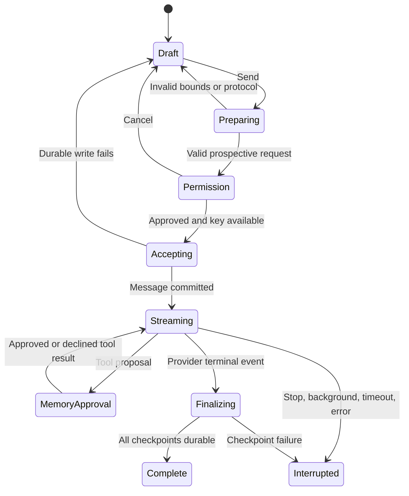
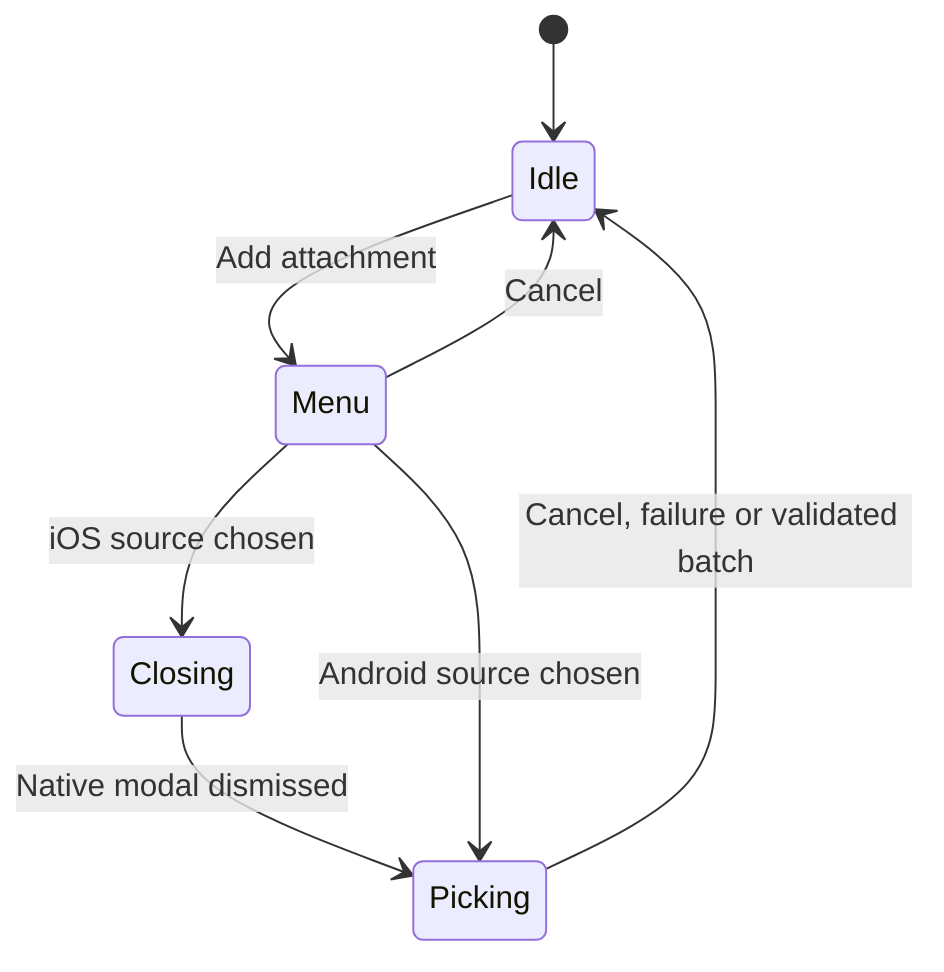

# Nylo state-machine audit

8 November 2026. Scope: all app-owned interaction, asynchronous work and persisted lifecycle state in `app/` and `src/`. Native OS pickers, React navigation and provider servers have internal machines Nylo does not own. This inventory documents Nylo’s boundaries to them; it does not claim those external internals were rewritten or fully tested. User asked to improve UX, DX and AX without losing behavior. AX includes predictable behavior for Nylo agents and clear contracts for future coding agents.

Decision: make risky new transitions explicit with small typed reducers and pure preparation functions. Keep the existing durable transaction and streaming machinery, with regression tests. A wholesale state-library migration would add risk without proving a better experience. No new state dependency or data-version reset is introduced.

## App-owned machines

| Machine and owner | States / transitions | Decision and UX / DX / AX contract |
| --- | --- | --- |
| Bootstrap — `store.tsx`, `_layout.tsx` | unopened → loading → recovered/ready; read/write failure → visible blocked/error | Preserve existing data, never fall back to overwriting a damaged database. UI announces opening/error; initialization has one durable recovery path. |
| Durable mutations — `persistence.ts` | queued → writing → committed; failure → rejected; next queued task can recover | Keep serialization. Render only committed state; a failed write must not poison future operations. Existing tests cover ordering and recovery. |
| Response checkpoint barrier — `persistence.ts` | collecting writes → drained; first failure latches failed and aborts → final failure | Keep the failure latch. A later successful storage task must not turn a failed response into a completed answer. |
| Native attachment storage — `attachment-storage.ts`, `storage.native.ts` | legacy inline / hydrated metadata+blobs → transactional blob writes+metadata → committed; missing blob → blocked read | Native checkpoints update metadata and only changed blobs. Blob cleanup is in the same transaction as metadata, so removed files are not retained as orphan rows. Public backups remain self-contained; incomplete/corrupt data is not silently overwritten. |
| Credential save — `credentials.ts`, `store.tsx` | serialized operation → retirement journal → secure write → metadata activation → retirement cleanup; failure → rollback/retry journal | Keep the transaction across secure storage and SQLite. No uncommitted key is promoted; failed cleanup remains recoverable. No new credential store is added. |
| Credential binding — `credentials.ts` | missing / legacy-unbound / matching destination / mismatch | Keep protocol+HTTPS-destination binding. A different endpoint/format requires explicit key entry; model changes do not duplicate keys. |
| Provider sharing — `consent.ts`, `store.tsx`, `domain.ts` | unapproved → native prompt → granted or cancelled; reset/key/destination/scope change → unapproved | Revision3 invalidates prior narrower approval. Cancel preserves draft. Attachment permission is separate on each attachment-bearing send/retry. Imported data cannot grant permission. |
| Provider editor — `connection.tsx` | no draft / new / editing; validation → serial save → saved; cancel → original | Preserve unsaved selection until explicit save; add synchronous action admission so repeated taps cannot overlap writes/discovery. Provider/protocol changes clear entered keys. |
| Model catalog — `model-catalog.ts`, `connection.tsx` | unloaded → loading → ready or failed; destination/key revision change → unloaded | **Typed reducer.** Saved selections are separate from discovered results. Explicit refresh always discovers; stale results cannot overwrite a new credential/destination revision. Select-all means shown IDs, not universal modality support. |
| Model routing — `model-library.ts`, chat | default → per-chat chosen provider/model; removed model → actionable validation error | One active model/send. Selection is persisted without a request. Existing single-model connections migrate, and invalid/removed choices preserve the editable draft. |
| Draft ownership — chat, `domain.ts` | empty → editing → debounce/focus/background durable save; prepared send → accepted message → clear corresponding draft | Chat and agent editors remount by record identity so navigation cannot attach an old record’s local state to a new ID. Text and attachments are one draft. Empty-chat reuse excludes any attachment-bearing draft and reserved diagnostic record; drafts appear in inbox/library. Only durable acceptance clears submitted work. |
| Send preparation — `send-plan.ts` | draft/history snapshot → prospective messages/context → validate bounds/protocol → prepared | **Pure prepare phase.** Invalid90k text or accumulated binary context fails before permission, persistence, acceptance or network. It leaves history and editable files untouched. Agents receive exactly the validated instructions/context. |
| Send execution — `store.tsx` | prepared → permission/key checks → active lease → durable acceptance → streaming/tools → checkpoint drain → complete; stop/timeout/background/storage/provider failure → interrupted/error | Keep existing exclusive active-response lease and checkpoint barrier. Recheck active foreground before acceptance. Partial text remains; retry creates an explicit new provider attempt. No automatic cost retry. |
| SSE parser — `sse.ts`, `providers.ts` | partial byte/frame buffer → decoded event → delta/tool call → terminal complete/error; EOF before terminal → interruption | Preserve protocol-specific decoding, Unicode splits and completion evidence. HTTP200 alone is not success. Keep regression coverage across three protocols. |
| Agent tool loop — `providers.ts`, store | model turn → proposed call → validation → approval → durable result → next turn; reject/abort/error → unchanged/action result | Bound five steps; no browser/code/app-control claims. Useful memory proposals may be suggested, but every save is approved, isolated to the agent and limited to50facts/1000characters. |
| Agent setup and role replacement — agent editor | new / edit / promoted chat; clean role → template; edited role → confirm/cancel → applied/preserved | Keep replacement confirmation and atomic promotion. Add save admission lock to prevent duplicate agents. Goal/workflow are explicit; no fabricated autonomous actions. |
| Recent-agent context — `agent-context.ts`, Memory | disabled → explicit enable → eligible excerpts; review/off/delete source → changed future context | Scoped same-agent only,8chats/12ktext, current/foreign/incomplete excluded. Durable facts and recent excerpts are different sources. Backups cannot silently enable sharing. Deleting a fact does not erase source chat mentions. |
| Memory editing — agent detail | idle → editing/new fact → durable save/cancel/delete confirmation | Keep manual memory controls and add mutation admission lock. Accessibility-sized actions stack below facts. Review-as-memory pre-fills an editable proposal; navigation never saves it automatically. |
| Attachment presentation — `attachment-flow.ts`, chat | idle → source menu → iOS closing → picking → idle; cancel menu → idle | **Typed reducer and one effect actor per operation ID.** iOS picker waits for native modal dismissal. Repeated choices/stale completion cannot open another picker or overwrite another chat’s draft. Android skips only the iOS dismissal stage. |
| Native attachment batch — `attachment-batch.ts`, picker | selection → count/source-byte validation → incremental conversion/byte budget → validated result; any outcome → cleanup all app-owned inputs | Fail before reading too many files. Every returned cache copy is scheduled for cleanup even when the first/middle conversion fails. Originals outside the cache directory are preserved. Each generated JPEG is cleaned after encoding; no automatic upload occurs. |
| OS camera/photo/document permission boundary — native picker | not requested → granted/denied/cancelled/unavailable → recoverable text chat | Camera requested only on explicit camera choice. System photo/document pickers, no microphone/broad-photo permission. Actual camera capture/denial and picker behavior still require native/physical evidence. |
| Keyboard and viewport — chat/header | hidden ↔ native shown; dismiss request → native hide event; near bottom ↔ user reading history | Keep actual native keyboard events as truth. Empty-chat size/layout changes scroll to the beginning; populated near-bottom chats follow new content. Never force a false “keyboard hidden” state. |
| Modal/navigation boundary — chat/provider/agent | tab/stack route ↔ focused modal; close → return to underlying route; missing/reserved record → guarded destination | Preserve existing tested navigation and reserved-record guards. Do not replace native stack navigation with a new router. Attachment dismissal has its own explicit handshake because it opens another native presenter. |
| Backup export/import — backup modules, store | choose/cancel → size+schema validation → replacement confirmation → serialized credential retirement + durable replacement; failure → old data retained | Shared UTF-8 byte bound for export/import, preserving Unicode round trips. Include attachments; exclude keys and sharing grants. No unrestoreable export based on character count. |
| Device-check lifecycle — `device-check.tsx`, store/domain | unprepared → reserved synthetic records → live attempt/memory approval → recall → new-runtime persistence check → scoped cleanup | Keep diagnostic identity separate from personal chats. Global send lease and local action lock govern attempts. Tool-free128token confirmations, no automatic reporting, no invented VoiceOver/physical pass. |
| Response reporting — `report.tsx` | editable report/excerpt opt-in → exact preview → OS email draft or unavailable; user separately sends/cancels; local removal confirms | No automatic network report or delivery claim. Default excludes response text, other chats/files/keys; visible support fallback and selected-answer removal. Monitored intake and App Review adequacy remain external validation gates. |
| Settings destructive actions — Settings/store | idle → confirmation/picker/share → serialized mutation → success/error | Keep existing confirmation and running-response guards. Export is separate from delete/restore; cancellation is not success. Do not silently erase keys, chats or files while another operation is active. |

## Explicit new transition contracts

## Evidence and remaining limits

New tests cover preflight non-mutation, cumulative context bounds, catalog stale events, picker ordering and stale completion, batch count/read/cleanup failure boundaries and UTF-8 backup agreement. Existing tests cover durable queue/checkpoints, credentials, consent, diagnostic isolation, provider parsing and model/memory contracts. This audit is not a claim that every OS or server transition has been exercised. Fresh native matrix/gallery, real file/photo/camera ingestion, live multimodal understanding, attachment-volume native performance, physical iPhone/VoiceOver and owner acceptance remain gates. Native artifacts and independent findings must be attached to the tested commit; review scores cannot replace those results.
